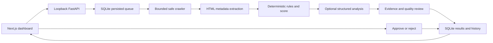

# Audit architecture and operational limits

## Data flow



Recommendation approval records content review. A separate GitHub App workflow publishes only an inspected, hash-bound metadata patch to a dedicated draft PR. Merge and deployment remain manual.

## Versioned offline demonstration

`demo.py` parses bundled HTML through extraction/rules/scoring, labels curated suggestions and sets `allow_ai=false`. `DEMO_REVISION` identifies the fixture/evidence revision; bump it when the sample or demonstrated evidence changes. The optional `Audit.demo_revision` defaults to null for older snapshots and live audits. Dashboard disclosures and report exports preserve this provenance without rewriting older records.

`POST /api/demo-audits` prepares a bounded offline candidate before entering `Store.get_or_create_demo`. A short `BEGIN IMMEDIATE` transaction uses a parameterized native SQLite JSON lookup over completed demo records for that exact revision, then either returns the existing snapshot with its decisions or inserts the candidate. Lookup is independent of the 100-row history listing, and the existing schema gains an idempotent mode/creation-time index. No tables, counters, historical scores or decision records are migrated or reset. Concurrent callers share one saved revision; failed/live records do not qualify. SQLite JSON functions are required. The existing short burst guard applies, while live-audit admissions and AI reservations are untouched.

## Reviewed repository fixes

The local operator configures a private GitHub App and owner allowlist, selects an installed repository and explicitly attests that it supplies the production origin. Projects bind numeric repository/installation IDs, base branch and application subdirectory. The App requests Metadata read, Contents write, Pull requests write and Actions read. Access is reauthorized before operations; repository-scoped installation tokens remain in server memory. The ignored server-side PEM key never enters API contracts, browser responses or reports.

Bounded source reads use one base SHA. The trusted TypeScript AST helper never executes target imports, configuration or scripts. It edits only static TypeScript App Router server-page titles/descriptions or statically understood page overrides. Dynamic metadata, Client Components, ambiguous roots/routes, percent-encoded URL paths and uncertain inheritance/title templates require manual work. Shared layouts, canonicals/indexing, redirects, dependencies, workflows and content are never edited.

Each immutable proposal binds its audit, repository, base commit, affected URLs/files, exact old/effective values and patch hash. Limits are three pages, five files, 100 changed lines and a 256 KiB exported diff. Reviewed suggestions or user-entered text supply values; patch generation makes zero OpenAI calls and private source never enters AI requests. Only separate explicit approval of the inspected hash authorizes `seopilot/<fix-run-id>`, one commit and a draft PR. No default-branch writes, force pushes, automatic repairs, merges or deployments occur.

Two publications are admitted globally per rolling 24 hours and one active fix per project. Uncertain writes retain their reservation and existing branch/commit/PR state is reconciled before another write. Status polling pauses after ten minutes until refreshed. Publication may start repository CI/preview automation, whose GitHub Actions usage is separate from OpenAI usage.

## Hosted checks and deployment evidence

The owner installs the workflow/harness from `validation/`; SEOPilot cannot write workflows. The template uses GitHub-hosted runners, pinned tooling, exact base/head checkouts, a ten-minute job timeout, read-only permissions and no persisted checkout credentials. Target scripts receive no OpenAI key, App key, SEOPilot database or GitHub token. An npm lockfile and production build are required. Declared lint, typecheck/type-check and test scripts run; absent optional scripts are reported skipped.

Chromium checks affected routes for success, meaningful content, approved metadata, console/page errors and preserved canonical/robots directives. JSON/screenshots have size and entry bounds. The backend accepts reports only from the configured workflow and matching repository, commit, run and proposal. Missing/invalid evidence remains a failure; no automatic repairs or reruns occur.

PR creation, checks, merge, awaiting deployment and live verification remain separate states. After manual deployment, Verify live starts a fresh frozen-URL audit with AI disabled and the existing DNS/SSRF/robots/resource safeguards and daily admission limit. Missing, blocked, failed or truncated metadata cannot pass. Findings compare by rule ID, normalized URL and evidence field. Historical scores remain unchanged. New deterministic analyses record rules version `2`; legacy audits retain rules version `1`, and scoring remains version `1`. Reduced coverage cannot establish score improvement.

Verification requires a nonempty target set and completed/partial deterministic analysis. Failed, interrupted or cancelled snapshots, body truncation and clipped metadata cannot verify matching prefixes. `compare_live` reuses `compare_audits` for finding changes and score comparability; absent diagnostic fields remain unresolved/unknown, and coverage or formula differences cannot establish a score improvement. Matching approved metadata can be verified while unrelated findings remain unknown. Cancelling the verification audit moves the fix run to `verification_failed`; a retry uses a fresh audit/admission with AI disabled.

## Saved audit comparisons and report exports

`reporting_api.py` exposes read-only operations over saved audit evidence, implemented in `audit_reporting.py`. Neither operation enqueues jobs, reserves live-audit admissions, calls AI providers, or writes findings or historical scores. The Next proxy allowlists the routes and methods; the local, single-user access boundary remains unchanged.

`POST /api/audit-comparisons` accepts `before_audit_id` and `after_audit_id` UUIDs. It requires two different saved audits with strictly increasing creation times, the same normalized origin (scheme, host, and port), and the same live/sample mode. Both must be in `completed`, `partial`, `failed`, `interrupted`, or `cancelled` status. Unknown IDs return `404`; incompatible pairs return `409`. The dashboard exposes the latest 100 history entries through **Audit history → Compare audits**, and performs the request only after **Run comparison**.

Finding identity is `(rule_id, normalized_url, primary_evidence_field, is_site)`, with a stable hash for display and original before/after issue IDs retained. Group findings expand to their affected URLs so a changed group representative or regenerated random ID does not manufacture a new finding. The result separates `added`, `persistent`, `resolved`, and `unresolved_unknown`, with reasons and later-evidence states, and lists common, newly assessed, and removed assessed URLs.

Comparison evidence is conservative. Matching findings can persist within the common assessed scope. Added/resolved classifications require the same rules, completed deterministic analysis in the relevant audit, and complete required evidence on every affected URL. Blocked, unchecked, missing, HTTP-error HTML evidence, truncated fields, missing diagnostic fields, and unverified site-policy checks can leave an observation unknown. Rules-version differences withhold added/resolved classifications. Findings only on newly assessed URLs are coverage changes rather than regressions. Resolving a finding means the recorded check no longer observes it within that evidence; it does not establish a search-performance outcome.

A score delta is nullable. It requires both audits to be `completed`, equal nonempty assessed URL sets, internally consistent coverage/page/score counts, no blocked/failed/unchecked pages or crawl/extraction limits, matching rule and score versions, identical score formulas, two available scores, and no unresolved/unknown findings. Otherwise the response retains both historical scores and supplies a reason for withholding the delta. The dashboard shows versions, coverage exclusions, limitations, and a sample disclosure when appropriate. Serialized comparison output is bounded to 1 MiB.

`GET /api/audits/{audit_id}/report/{format}` supports `markdown`, `csv`, and `json` after any finished audit status. It returns `{filename, media_type, content}`; **Report format → Download report** prepares a plain browser download. Exports contain public saved evidence, score/formula/versions, coverage, recommendation source/basis/review status, applicable decision and finding-disposition history, and unresolved limitations. Review history is restricted to IDs belonging to that audit. AI and sample suggestions are labelled hypotheses requiring human review; approval never becomes proof of implementation. Credentials, provider responses, and private repository source are not included.

Report text and the serialized response envelope are each limited to 1 MiB of UTF-8; an oversized result returns `409` instead of silently truncating evidence. Filenames derive from a sanitized audit ID. Markdown escapes source HTML and syntax characters. CSV uses the standard library's quoting and prefixes cells with an apostrophe when their first significant character is `=`, `+`, `-`, `@`, tab, or carriage return, including prefixes hidden by leading whitespace. No report format executes page content.

The prior hosted V2 baseline covered 356 backend tests and 15 browser scenarios. The [saved-evidence hosted run](https://github.com/thanushreesuresh/SEOpilot/actions/runs/40132659834) passed 465 backend tests and all 23 browser scenarios on source `39b31e5`, including eight reporting/JSON-LD cases and keyboard table scrolling. The [subsequent cancellation run](https://github.com/thanushreesuresh/SEOpilot/actions/runs/40135903810) passed 498 backend tests and all 26 browser scenarios on `da67735`. The history table positions header cells so the absolute hidden “Open” label remains within its horizontal scroll boundary; the page stays within the 390-pixel mobile viewport.

## Crawl boundaries

The submitted origin is the permission boundary, including scheme and port. Cross-origin redirects, including a different `www` hostname or HTTP-to-HTTPS upgrade, are refused. Submit the final public HTTPS origin when appropriate. External canonical references are inspected as text, not fetched.

Every outbound crawler connection validates URL syntax, standard port, and all DNS answers. The selected public address is pinned at the TCP layer while the original host remains responsible for HTTP Host, TLS SNI, and certificate verification. Private, reserved, mapped, link-local, metadata, and other restricted destinations are rejected. Proxies, authentication headers, and cookies are not forwarded.

Crawling is sequential and bounded: 15 pages by default (maximum 30), depth 2 (maximum 3), 750 ms minimum delay, 10-second per-request deadline, 120-second crawl budget, 2 MiB response limit, 60 total requests, and 500 discovered URLs. Robots crawl-delay can increase the delay. Limits are snapshotted with each audit, and incomplete coverage is displayed.

Protego interprets robots rules. Confirmed missing robots files are distinguished from denied or unavailable policies. Robots failures stop crawling conservatively. All redirects and auxiliary probes remain subject to the same destination policy and budgets.

HTML is parsed without executing scripts. JavaScript-only content, logged-in pages, external resources, and private networks are unsupported. Unsupported responses, blocked pages, timeouts, and unvisited links remain unknown rather than fabricated findings. Only observed 404/410 targets are labelled broken links. Ordinary link discovery cannot establish orphan pages.

## Bounded JSON-LD diagnostics

Before discarding scripts from extracted HTML, `structured_data.py` inspects inline `application/ld+json` blocks without fetching contexts or expanding remote vocabularies. The persisted `Page.structured_data` projection contains a block count, declared type labels, fixed diagnostic messages with one-based block indexes and sanitized evidence, and a truncation flag. Raw JSON-LD and source-bearing decoder exception text are not persisted or returned. A legacy `null` summary means inspection was not recorded; zero blocks indicates absence only when inspection was complete. A clipped HTML body leaves JSON-LD presence and syntax unknown.

Inspection is bounded to 10 blocks, 16 KiB per block, 64 KiB combined, nesting depth 32, 20 distinct type labels of at most 120 characters, and 50 observations. Oversized or deep blocks are omitted whole; a clipped prefix does not produce a fabricated syntax error. Limits mark structured-data evidence incomplete and do not themselves create a scored finding. The existing 2 MiB HTML-body limit still applies.

Diagnostics cover invalid JSON, duplicate keys, unsupported non-finite numeric constants, unsuitable root/@graph structures, and context review. Missing or unfamiliar contexts are low-severity review advice because fully qualified IRIs and custom vocabularies can be valid. Syntax/structure problems produce medium-severity observations. This shallow inspector does not implement full JSON-LD processing, Schema.org validation, required-property validation, or rich-result eligibility. The **Pages** tab exposes the bounded summary and its limits; JSON-LD findings enter the ordinary evidence/recommendation workflow.

Newly analyzed live and sample audits record rules version `2`. Existing snapshots keep rules version `1`, original evidence, and historical scores; they are not silently reanalyzed. The score algorithm remains version `1`, although additional rules can change a newly computed value. Cross-version comparisons therefore disclose the mismatch and withhold a comparable score delta and unsupported added/resolved conclusions.

The bounded checks refer to the W3C [JSON-LD grammar](https://www.w3.org/TR/json-ld11/#json-ld-grammar) and [HTML embedding rules](https://www.w3.org/TR/json-ld11/#embedding-json-ld-in-html-documents). They deliberately implement only the diagnostics described above.

## Health score

The score is an internal diagnostic heuristic, not a Google metric or a ranking prediction.

```text
severity points: Critical 20, High 10, Medium 5, Low 2
page penalty = min(100, sum(points for unique rules affecting the page))
HTTP error page penalty = 100
site penalty = min(20, sum(points for unique site-level rules))
score = clamp(round(100 - mean(page penalties) - site penalty), 0, 100)
```

Only successfully assessed HTML pages and confirmed HTTP-error responses enter the denominator. Excluded and unknown pages cannot improve it. No assessed pages means no score. Duplicate-title/description groups affect each page once; repeated instances of the same rule on a page do not multiply the penalty.

New calculations attach an optional `Score.breakdown` snapshot, produced from the same rule aggregation that computes the score. It retains per-page raw rule points, capped penalties and contributing rules; unique site-rule inputs and their cap; the mean and unrounded result; and excluded page records. The calculation uses nearest-integer rounding with ties to even, followed by the 0–100 clamp. Zero assessed pages retains exclusions with null mean/unrounded value and a null score. This additive JSON payload requires no schema migration; older scores keep a null breakdown and are not recomputed. Decisions and dispositions do not rewrite the snapshot.

The dashboard displays the saved breakdown inside the existing score disclosure and can apply a page URL to the finding search. Reports reuse the saved data: Markdown explains caps/overrides, JSON retains numeric precision, and CSV emits separate typed rows rather than a Python dictionary in a cell. Existing escaping, spreadsheet-formula protection and the 1 MiB export limits apply. No provider/network requests or new audit admissions are needed; weights, assessed denominator and rule/score versions remain unchanged.

Title length defaults to a 15–60 character review range; descriptions use 50–160. These configurable editorial heuristics are not universal search-engine requirements. Multiple H1s, noindex, empty alt on decorative images, and canonical references require context. No rule guarantees traffic, ranking changes, or a penalty.

## AI evidence boundary

Live analysis requires a server-side `OPENAI_API_KEY`; `OPENAI_MODEL` defaults to the only allowed ID, `gpt-6-luna`. At most two bounded structured calls perform grouped technical/content/keyword analysis and independent review. Each call reserves a durable global allowance before invocation, with a default of 20 per rolling 24 hours and two per audit lifetime. Reservations are never refunded after failure. SDK retries and environment proxies are disabled; requests use the fixed official OpenAI endpoint, a 40,000-byte input ceiling and at most 2,500 output tokens including reasoning. Context is further bounded to four HTML pages, 20 findings and 18,000 UTF-8 bytes. Models receive no tools or unrestricted network access. Provider response storage is disabled in requests. A server kill switch and per-audit `allow_ai=false` prevent all AI calls.

The backend validates Pydantic output, page/issue/evidence ownership, literal quotations, output bounds, unsupported metrics, duplicated suggestions, and conflicting edits. Only accepted, revalidated recommendations are shown. Keyword themes and search intent are inferred; no search-volume or performance data exists in this MVP. AI cannot alter verified findings or the score. Missing credentials and provider failures leave deterministic recommendations available.

The sample mode parses bundled HTML fixtures, includes a simulated missing page, and uses curated suggestions. Its results are always labelled as sample data and never stand in for a failed live audit.

## Persistence and recovery

SQLite stores structured page metadata and bounded excerpts, not complete HTML, response bodies, cookies, or credentials. Normalized child records accompany audit snapshots for atomic persistence. Decision events are append-only; repeating an unchanged decision is idempotent.

Run one API process with one lifespan-managed worker. Queued runs remain queued across restarts; previously active runs become interrupted with existing evidence preserved. Restart recovery does not silently resume network requests or generate new AI calls. Start a new audit to retry.

Audit cancellation is a durable terminal snapshot, not deletion. `Store.cancel_audit` changes an active run under `BEGIN IMMEDIATE`, preserves its collected evidence and records `completed_at`. Repeated cancellation is idempotent; ordinary terminal states cannot be cancelled. AI reservation writes share the same database lock and reject cancelled IDs; existing admission/reservation rows are untouched. Snapshot writes cannot move a cancelled run back to an active/completed state, preventing stale callbacks from resurrecting it. Retained recommendations remain reviewable with append-only decision events.

The worker runs the audit processor as a child task and checks a status-only cancellation query every 300 ms while awaiting work. It cancels and drains that child before taking another job. Lifespan cancellation still propagates to the worker and its child; server shutdown marks unfinished active work interrupted while a durable user cancellation stays cancelled. Cleanup is cooperative, so already-started requests may finish or remain billable. No target scripts or extra AI calls are introduced by cancellation.

Child tasks are drained even when they have already failed, avoiding unobserved source-bearing exceptions. If cleanup fails during parent shutdown, the worker preserves cancellation instead of treating that error as an ordinary job failure and continuing. Logs use a generic audit-ID warning without the provider/transport exception body. Tests cover shutdown while user-cancellation cleanup is already running.

SQLite schema version 3 preserves schema-2 admissions, pseudonymous identities, persistent HMAC salt and AI reservations, and adds project connections, immutable proposals, timestamped checkpoints, publication reservations and append-only finding dispositions. Three admissions per rolling 24 hours are enforced atomically with queue insertion under `BEGIN IMMEDIATE`. Ordinary duplicates reuse an active audit or a completed result admitted within 15 minutes. Verification includes its exact URL set and never reuses a completed result. Admitted failures remain charged; queue rejection and invalid input are not charged. Preserve the database across restarts/upgrades; user counters were never reset during development.

Private source/patches live in ignored `fix-artifacts` storage beside the database with a 24-hour deadline. Exports reject expired data; cleanup purges files while the worker runs and after restart. Immediate deletion/disconnection interrupts active work and purges retained source, while preserving historical hashes/metadata/results. It does not delete the user-managed PEM file or existing GitHub branches/PRs. Intentional/dismissed dispositions record reasons and the latest assessment without rewriting evidence or scores.

The Next Pages API proxy uses its socket peer, discards arbitrary forwarding/private headers and stamps identity with an authenticated local token. It forwards only allowlisted routes/methods to the fixed loopback API, bounded JSON bodies and safe response headers. FastAPI accepts stamped identity only from loopback with a constant-time matching 64-character ASCII token. IPv4-mapped addresses normalize to IPv4; IPv6 shares a `/64` allowance. Raw IP addresses are not persisted in the admission table. The generated token remains in an ignored private runtime file, excluded from bundling; token/configuration errors fail closed. Use `python -m seopilot`, which disables Uvicorn proxy-header trust and access logs. Unauthenticated forwarded headers must never become the transport identity.

This local release has no account system or hosted tenant isolation. Keep services bound to loopback, keep database files private and untracked, and avoid sharing the live SQLite database between machines. Local clients normally share one loopback allowance. A front proxy similarly produces one conservative shared identity; no trusted edge integration is assumed. Public deployment still requires authentication, user ownership enforcement, durable worker coordination and edge abuse controls. IP quotas alone cannot stop distributed clients; the global paid-call allowance provides an additional resource ceiling. Request reservations are not billing telemetry; use a restricted OpenAI project key and provider spend controls as an independent monetary limit.

## Deferred integrations

Google Search Console is not connected. No clicks, impressions, CTR, positions, traffic, or backlink statistics are fabricated. A future adapter must use official authorization, least-privilege scopes, server-protected tokens, and actual authorized properties without making core audits depend on it.
