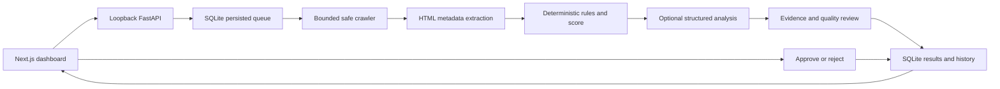

# Audit architecture and operational limits

## Data flow



There is no website-write path. Approval records a decision; copyable suggestions must be applied manually outside SEOPilot.

## Crawl boundaries

The submitted origin is the permission boundary, including scheme and port. Cross-origin redirects, including a different `www` hostname or HTTP-to-HTTPS upgrade, are refused. Submit the final public HTTPS origin when appropriate. External canonical references are inspected as text, not fetched.

Every outbound crawler connection validates URL syntax, standard port, and all DNS answers. The selected public address is pinned at the TCP layer while the original host remains responsible for HTTP Host, TLS SNI, and certificate verification. Private, reserved, mapped, link-local, metadata, and other restricted destinations are rejected. Proxies, authentication headers, and cookies are not forwarded.

Crawling is sequential and bounded: 15 pages by default (maximum 30), depth 2 (maximum 3), 750 ms minimum delay, 10-second per-request deadline, 120-second crawl budget, 2 MiB response limit, 60 total requests, and 500 discovered URLs. Robots crawl-delay can increase the delay. Limits are snapshotted with each audit, and incomplete coverage is displayed.

Protego interprets robots rules. Confirmed missing robots files are distinguished from denied or unavailable policies. Robots failures stop crawling conservatively. All redirects and auxiliary probes remain subject to the same destination policy and budgets.

HTML is parsed without executing scripts. JavaScript-only content, logged-in pages, external resources, and private networks are unsupported. Unsupported responses, blocked pages, timeouts, and unvisited links remain unknown rather than fabricated findings. Only observed 404/410 targets are labelled broken links. Ordinary link discovery cannot establish orphan pages.

## Health score

The score is an internal diagnostic heuristic, not a Google metric or a ranking prediction.

```text
severity points: Critical 20, High 10, Medium 5, Low 2
page penalty = min(100, sum(points for unique rules affecting the page))
HTTP error page penalty = 100
site penalty = min(20, sum(points for unique site-level rules))
score = clamp(round(100 - mean(page penalties) - site penalty), 0, 100)
```

Only successfully assessed HTML pages and confirmed HTTP-error responses enter the denominator. Excluded and unknown pages cannot improve it. No assessed pages means no score. Duplicate-title/description groups affect each page once; repeated instances of the same rule on a page do not multiply the penalty.

Title length defaults to a 15–60 character review range; descriptions use 50–160. These configurable editorial heuristics are not universal search-engine requirements. Multiple H1s, noindex, empty alt on decorative images, and canonical references require context. No rule guarantees traffic, ranking changes, or a penalty.

## AI evidence boundary

Live analysis requires both server-side `OPENAI_API_KEY` and `OPENAI_MODEL`. Two bounded structured calls perform grouped technical/content/keyword analysis and independent review. Inputs contain bounded page excerpts, actual metadata and finding evidence IDs, plus optional business context. Models receive no tools or unrestricted network access. Provider response storage is disabled in requests.

The backend validates Pydantic output, page/issue/evidence ownership, literal quotations, output bounds, unsupported metrics, duplicated suggestions, and conflicting edits. Only accepted, revalidated recommendations are shown. Keyword themes and search intent are inferred; no search-volume or performance data exists in this MVP. AI cannot alter verified findings or the score. Missing credentials and provider failures leave deterministic recommendations available.

The sample mode parses bundled HTML fixtures, includes a simulated missing page, and uses curated suggestions. Its results are always labelled as sample data and never stand in for a failed live audit.

## Persistence and recovery

SQLite stores structured page metadata and bounded excerpts, not complete HTML, response bodies, cookies, or credentials. Normalized child records accompany audit snapshots for atomic persistence. Decision events are append-only; repeating an unchanged decision is idempotent.

Run one API process with one lifespan-managed worker. Queued runs remain queued across restarts; previously active runs become interrupted with existing evidence preserved. Restart recovery does not silently resume network requests or generate new AI calls. Start a new audit to retry.

This local release has no account system or hosted tenant isolation. Keep services bound to loopback, keep database files private and untracked, and avoid sharing the live SQLite database between machines. Public deployment requires authentication, user ownership enforcement, durable worker coordination, and an operational rate-limit design.

## Deferred integrations

Google Search Console is not connected. No clicks, impressions, CTR, positions, traffic, or backlink statistics are fabricated. A future adapter must use official authorization, least-privilege scopes, server-protected tokens, and actual authorized properties without making core audits depend on it.
