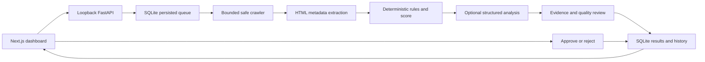

# Audit architecture and operational limits

## Data flow



Recommendation approval records content review. A separate GitHub App workflow publishes only an inspected, hash-bound metadata patch to a dedicated draft PR. Merge and deployment remain manual.

## Reviewed repository fixes

The local operator configures a private GitHub App and owner allowlist, selects an installed repository and explicitly attests that it supplies the production origin. Projects bind numeric repository/installation IDs, base branch and application subdirectory. The App requests Metadata read, Contents write, Pull requests write and Actions read. Access is reauthorized before operations; repository-scoped installation tokens remain in server memory. The ignored server-side PEM key never enters API contracts, browser responses or reports.

Bounded source reads use one base SHA. The trusted TypeScript AST helper never executes target imports, configuration or scripts. It edits only static TypeScript App Router server-page titles/descriptions or statically understood page overrides. Dynamic metadata, Client Components, ambiguous roots/routes, percent-encoded URL paths and uncertain inheritance/title templates require manual work. Shared layouts, canonicals/indexing, redirects, dependencies, workflows and content are never edited.

Each immutable proposal binds its audit, repository, base commit, affected URLs/files, exact old/effective values and patch hash. Limits are three pages, five files, 100 changed lines and a 256 KiB exported diff. Reviewed suggestions or user-entered text supply values; patch generation makes zero OpenAI calls and private source never enters AI requests. Only separate explicit approval of the inspected hash authorizes `seopilot/<fix-run-id>`, one commit and a draft PR. No default-branch writes, force pushes, automatic repairs, merges or deployments occur.

Two publications are admitted globally per rolling 24 hours and one active fix per project. Uncertain writes retain their reservation and existing branch/commit/PR state is reconciled before another write. Status polling pauses after ten minutes until refreshed. Publication may start repository CI/preview automation, whose GitHub Actions usage is separate from OpenAI usage.

## Hosted checks and deployment evidence

The owner installs the workflow/harness from `validation/`; SEOPilot cannot write workflows. The template uses GitHub-hosted runners, pinned tooling, exact base/head checkouts, a ten-minute job timeout, read-only permissions and no persisted checkout credentials. Target scripts receive no OpenAI key, App key, SEOPilot database or GitHub token. An npm lockfile and production build are required. Declared lint, typecheck/type-check and test scripts run; absent optional scripts are reported skipped.

Chromium checks affected routes for success, meaningful content, approved metadata, console/page errors and preserved canonical/robots directives. JSON/screenshots have size and entry bounds. The backend accepts reports only from the configured workflow and matching repository, commit, run and proposal. Missing/invalid evidence remains a failure; no automatic repairs or reruns occur.

PR creation, checks, merge, awaiting deployment and live verification remain separate states. After manual deployment, Verify live starts a fresh frozen-URL audit with AI disabled and the existing DNS/SSRF/robots/resource safeguards and daily admission limit. Missing, blocked, failed or truncated metadata cannot pass. Findings compare by rule ID, normalized URL and evidence field. Historical scores remain unchanged; rule/scoring versions are `1`, and reduced coverage cannot establish score improvement.

## Crawl boundaries

The submitted origin is the permission boundary, including scheme and port. Cross-origin redirects, including a different `www` hostname or HTTP-to-HTTPS upgrade, are refused. Submit the final public HTTPS origin when appropriate. External canonical references are inspected as text, not fetched.

Every outbound crawler connection validates URL syntax, standard port, and all DNS answers. The selected public address is pinned at the TCP layer while the original host remains responsible for HTTP Host, TLS SNI, and certificate verification. Private, reserved, mapped, link-local, metadata, and other restricted destinations are rejected. Proxies, authentication headers, and cookies are not forwarded.

Crawling is sequential and bounded: 15 pages by default (maximum 30), depth 2 (maximum 3), 750 ms minimum delay, 10-second per-request deadline, 120-second crawl budget, 2 MiB response limit, 60 total requests, and 500 discovered URLs. Robots crawl-delay can increase the delay. Limits are snapshotted with each audit, and incomplete coverage is displayed.

Protego interprets robots rules. Confirmed missing robots files are distinguished from denied or unavailable policies. Robots failures stop crawling conservatively. All redirects and auxiliary probes remain subject to the same destination policy and budgets.

HTML is parsed without executing scripts. JavaScript-only content, logged-in pages, external resources, and private networks are unsupported. Unsupported responses, blocked pages, timeouts, and unvisited links remain unknown rather than fabricated findings. Only observed 404/410 targets are labelled broken links. Ordinary link discovery cannot establish orphan pages.

## Health score

The score is an internal diagnostic heuristic, not a Google metric or a ranking prediction.

```text
severity points: Critical 20, High 10, Medium 5, Low 2
page penalty = min(100, sum(points for unique rules affecting the page))
HTTP error page penalty = 100
site penalty = min(20, sum(points for unique site-level rules))
score = clamp(round(100 - mean(page penalties) - site penalty), 0, 100)
```

Only successfully assessed HTML pages and confirmed HTTP-error responses enter the denominator. Excluded and unknown pages cannot improve it. No assessed pages means no score. Duplicate-title/description groups affect each page once; repeated instances of the same rule on a page do not multiply the penalty.

Title length defaults to a 15–60 character review range; descriptions use 50–160. These configurable editorial heuristics are not universal search-engine requirements. Multiple H1s, noindex, empty alt on decorative images, and canonical references require context. No rule guarantees traffic, ranking changes, or a penalty.

## AI evidence boundary

Live analysis requires a server-side `OPENAI_API_KEY`; `OPENAI_MODEL` defaults to the only allowed ID, `gpt-6-luna`. At most two bounded structured calls perform grouped technical/content/keyword analysis and independent review. Each call reserves a durable global allowance before invocation, with a default of 20 per rolling 24 hours and two per audit lifetime. Reservations are never refunded after failure. SDK retries and environment proxies are disabled; requests use the fixed official OpenAI endpoint, a 40,000-byte input ceiling and at most 2,500 output tokens including reasoning. Context is further bounded to four HTML pages, 20 findings and 18,000 UTF-8 bytes. Models receive no tools or unrestricted network access. Provider response storage is disabled in requests. A server kill switch and per-audit `allow_ai=false` prevent all AI calls.

The backend validates Pydantic output, page/issue/evidence ownership, literal quotations, output bounds, unsupported metrics, duplicated suggestions, and conflicting edits. Only accepted, revalidated recommendations are shown. Keyword themes and search intent are inferred; no search-volume or performance data exists in this MVP. AI cannot alter verified findings or the score. Missing credentials and provider failures leave deterministic recommendations available.

The sample mode parses bundled HTML fixtures, includes a simulated missing page, and uses curated suggestions. Its results are always labelled as sample data and never stand in for a failed live audit.

## Persistence and recovery

SQLite stores structured page metadata and bounded excerpts, not complete HTML, response bodies, cookies, or credentials. Normalized child records accompany audit snapshots for atomic persistence. Decision events are append-only; repeating an unchanged decision is idempotent.

Run one API process with one lifespan-managed worker. Queued runs remain queued across restarts; previously active runs become interrupted with existing evidence preserved. Restart recovery does not silently resume network requests or generate new AI calls. Start a new audit to retry.

SQLite schema version 3 preserves schema-2 admissions, pseudonymous identities, persistent HMAC salt and AI reservations, and adds project connections, immutable proposals, timestamped checkpoints, publication reservations and append-only finding dispositions. Three admissions per rolling 24 hours are enforced atomically with queue insertion under `BEGIN IMMEDIATE`. Ordinary duplicates reuse an active audit or a completed result admitted within 15 minutes. Verification includes its exact URL set and never reuses a completed result. Admitted failures remain charged; queue rejection and invalid input are not charged. Preserve the database across restarts/upgrades; user counters were never reset during development.

Private source/patches live in ignored `fix-artifacts` storage beside the database with a 24-hour deadline. Exports reject expired data; cleanup purges files while the worker runs and after restart. Immediate deletion/disconnection interrupts active work and purges retained source, while preserving historical hashes/metadata/results. It does not delete the user-managed PEM file or existing GitHub branches/PRs. Intentional/dismissed dispositions record reasons and the latest assessment without rewriting evidence or scores.

The Next Pages API proxy uses its socket peer, discards arbitrary forwarding/private headers and stamps identity with an authenticated local token. It forwards only allowlisted routes/methods to the fixed loopback API, bounded JSON bodies and safe response headers. FastAPI accepts stamped identity only from loopback with a constant-time matching 64-character ASCII token. IPv4-mapped addresses normalize to IPv4; IPv6 shares a `/64` allowance. Raw IP addresses are not persisted in the admission table. The generated token remains in an ignored private runtime file, excluded from bundling; token/configuration errors fail closed. Use `python -m seopilot`, which disables Uvicorn proxy-header trust and access logs. Unauthenticated forwarded headers must never become the transport identity.

This local release has no account system or hosted tenant isolation. Keep services bound to loopback, keep database files private and untracked, and avoid sharing the live SQLite database between machines. Local clients normally share one loopback allowance. A front proxy similarly produces one conservative shared identity; no trusted edge integration is assumed. Public deployment still requires authentication, user ownership enforcement, durable worker coordination and edge abuse controls. IP quotas alone cannot stop distributed clients; the global paid-call allowance provides an additional resource ceiling. Request reservations are not billing telemetry; use a restricted OpenAI project key and provider spend controls as an independent monetary limit.

## Deferred integrations

Google Search Console is not connected. No clicks, impressions, CTR, positions, traffic, or backlink statistics are fabricated. A future adapter must use official authorization, least-privilege scopes, server-protected tokens, and actual authorized properties without making core audits depend on it.
